# Лабораторная работа №2: Модели. CRUD.

**Студент:** Хвостов Ростислав Романович

**Группа:** ПИЖ-б-о-25-2

## Цель работы
Разработка моделей, научиться проводить миграцию данных, работа с базой данных.

## Ход работы
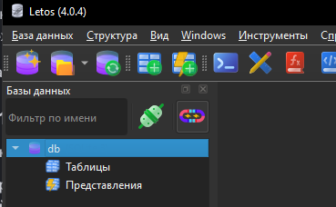

Добавил БД в Letos

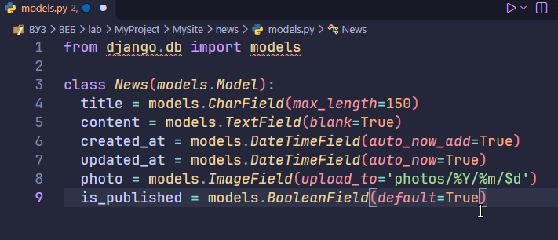

Создал модель News в models.py

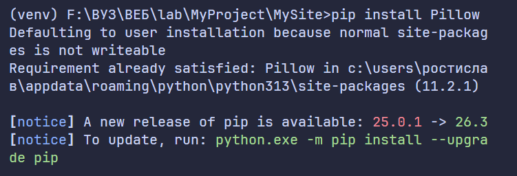

Установил библиотеку Pillow

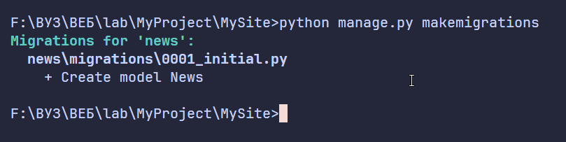

Создал миграцию

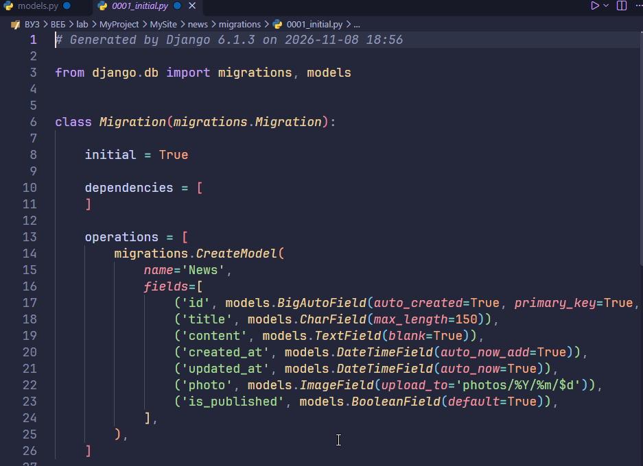

Файл 0001_initial.py

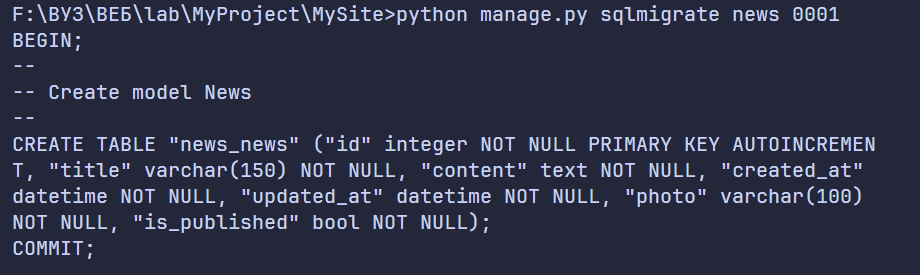

Результат выполнения команды `python manage.py sqlmigrate news 0001`

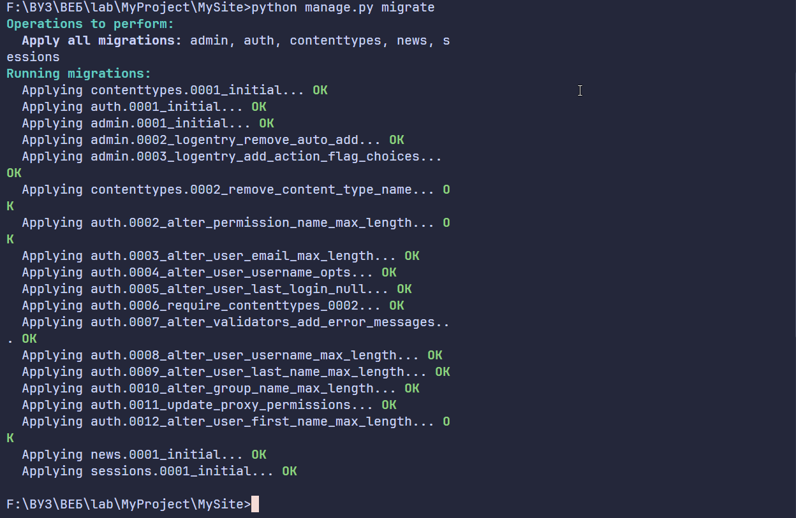

Выполнил миграцию

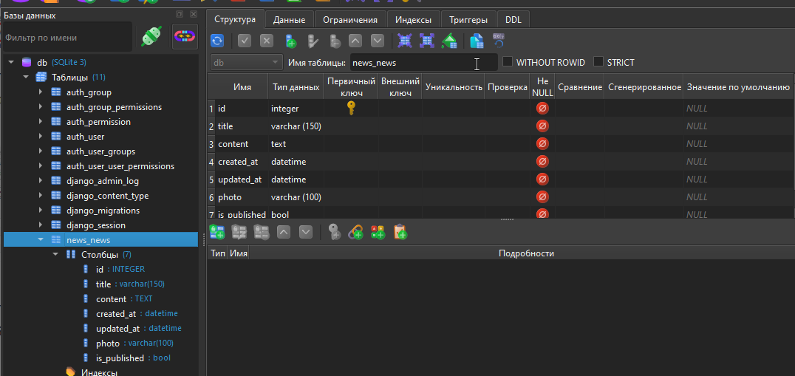

Таблица news_news

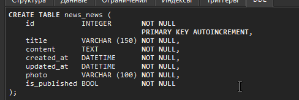

SQL запрос, который был использован для таблицы news_news

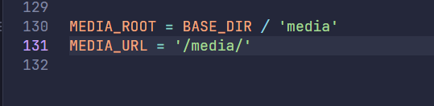

Настроил константы MEDIA_ROOT И MEDIA_URL

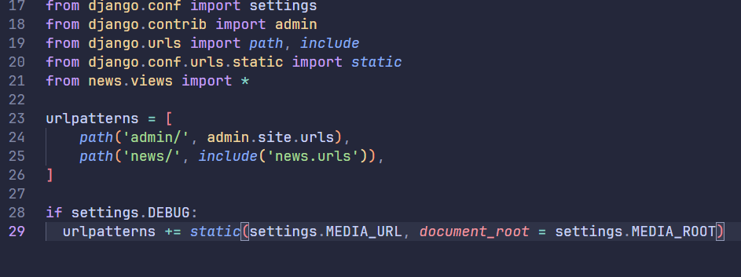

Создал маршрут для получения медиа

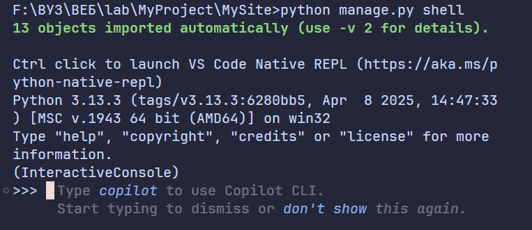

Запустил консоль django

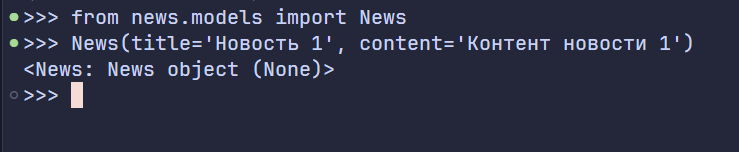

Импортировал модель и вызвал конструктор

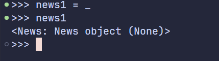

Присвоил объект переменной news1

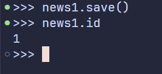

Сохранил запись и вывел id

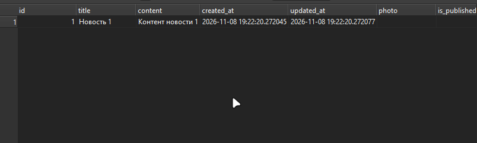

Новая запись в БД

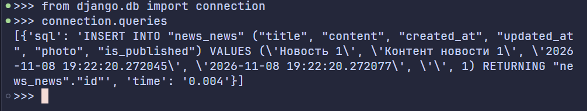

Импортировал connection и посмотрел его queries

Вывел свойство pk

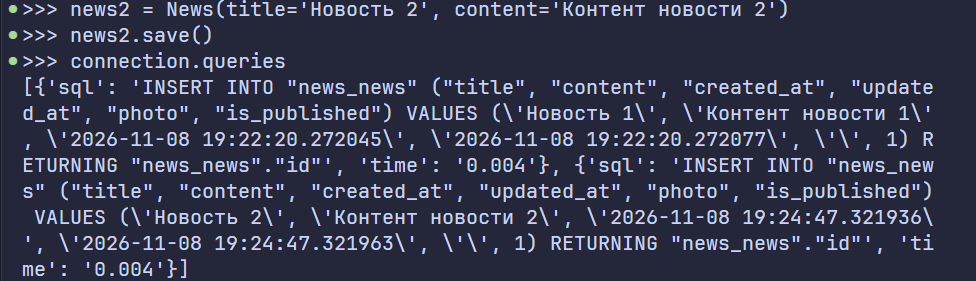

Создал и сохранил запись news2

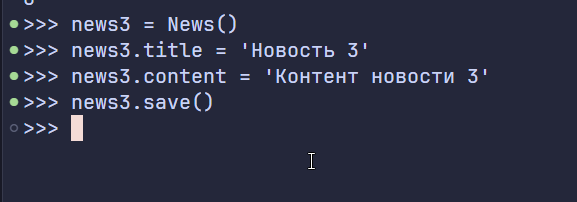

Создал и сохранил запись news3

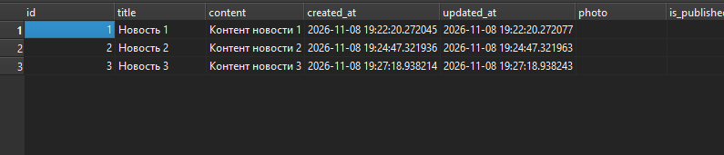

Новые записи в БД

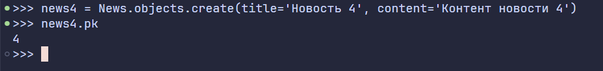

Создал и сохранил запись news4

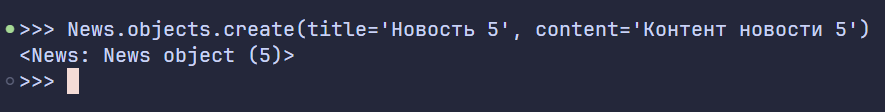

Создал и сохранил запись news5

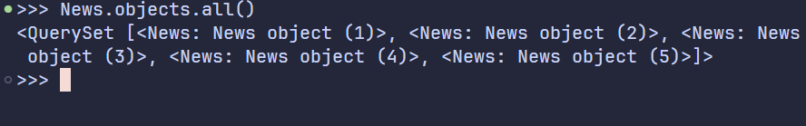

Вернул все записи

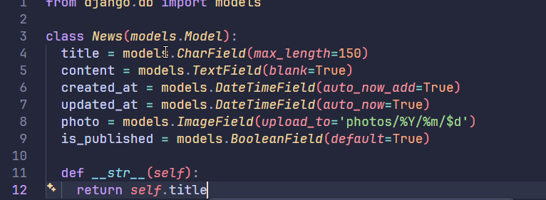

В модели News описал метод для возврата названия объекта

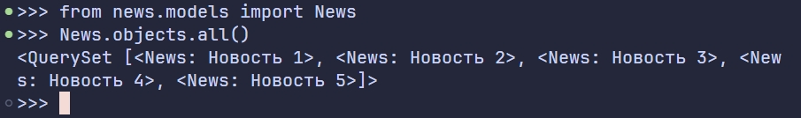

Вернул все записи с названиями

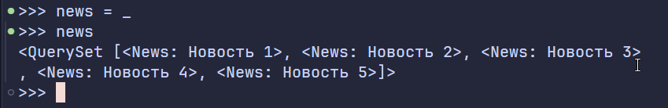

Сохранил набор объектов в news

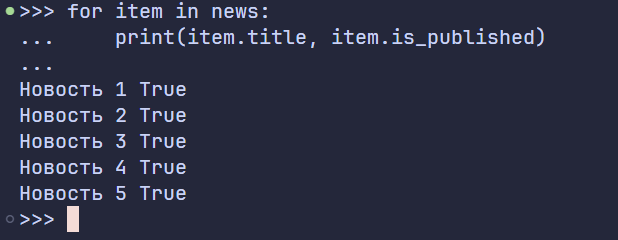

Вывел список новостей с помощью цикла for

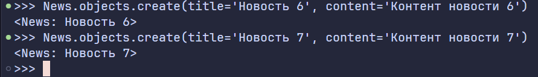

Создал и сохранил записи news6 и news7

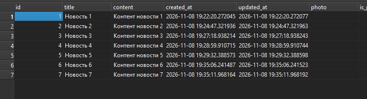

Новые записи в БД

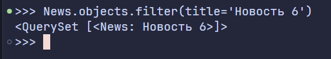

Отфильтровал объекты по названию

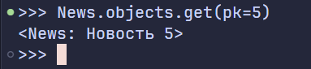

Получил запись по id с помощью метода get()

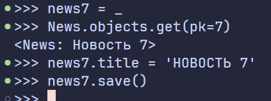

Обновил название записи

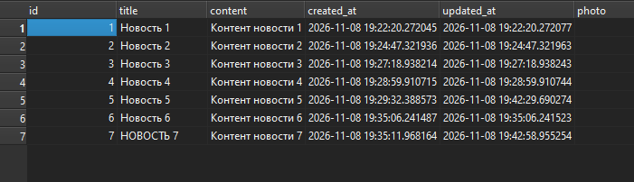

Обновленные записи в БД

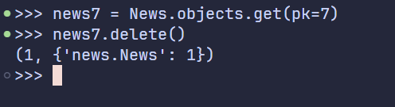

Удалил объект

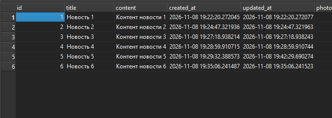

Обновленные записи в БД

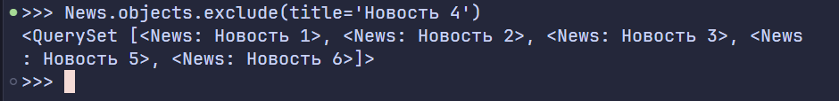

Исключил из вывода запись по названию

# Индивидуальное задание
Создание модели
- Модель: Post (поля: title, content, author, created_at, is_published).
- Добавить поле views_count (целое число, по умолчанию 0).
- Написать метод __str__, возвращающий заголовок поста.
- Вывести все посты, у которых is_published=True.

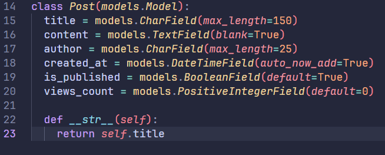

Класс Post со всеми полями и методами 

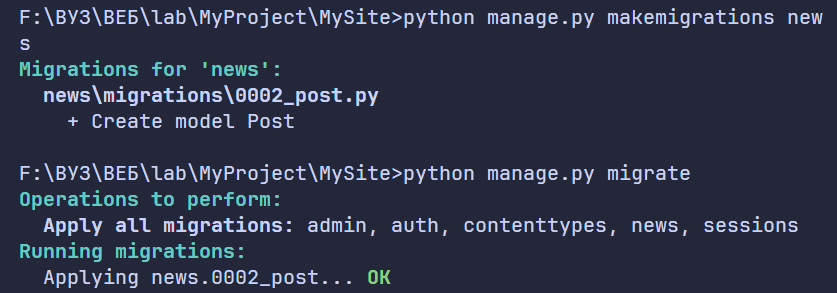

Создал и выполнил миграцию

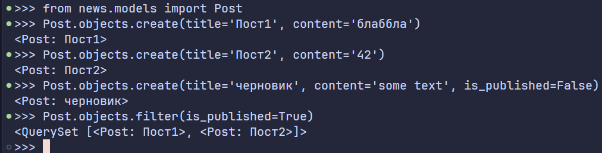

В консоли django создал объекты и отфильтровал по полю `is_pudlished` с помощью метода filter()

# Вывод
Разработали модели, научились проводить миграцию данных, работать с базой данных.

# Контрольные вопросы
1. Что такое модель в Django и для чего она используется?
Ответ: Это класс, описывающий таблицу БД. Используется для работы с данными через ORM.

2. Какие типы полей вы знаете? Приведите примеры.
Ответ: CharField - текстовое поле, IntegerField - целое число, DateField - дата, BooleanField - true или false.

3. Чем отличаются параметры blank=True и null=True?
Ответ: null=True значит, что null - допустимое значение в поле; blank=True - поле может быть пустым.

4. Что такое миграции и зачем они нужны? Опишите основные команды для работы с ними.
Ответ: Версионирование схемы БД. Команды: makemigrations и migrate.

5. Как создать суперпользователя для доступа к административной панели Django?
Ответ: python manage.py createsuperuser.

6. Что такое ORM? Перечислите основные методы для выполнения операций CRUD.
Ответ: ORM - это технология для связи объектов Python с таблицами БД. Методы: create, save, filter, get, delete.

7. В чем разница между методами filter() и get()?
Ответ: filter() возвращает QuerySet, get() - один объект или исключение.

8. Как настроить загрузку изображений (медиафайлов) в проекте Django?
Ответ: Задать MEDIA_ROOT и MEDIA_URL, использовать ImageField, настроить раздачу в urls.py.

9. Для чего нужен метод __str__ в модели?
Ответ: Для строкового представления объекта.

10. Что произойдёт, если выполнить python manage.py makemigrations, но не выполнить migrate?
Ответ: Файлы миграций создадутся, но изменения в БД не применятся.
