# Лабораторная работа №1: настроить виртуальное пространство. Разработать контроллер приложения и организовать маршруты

**Студент:** Хвостов Ростислав Романович

**Группа:** ПИЖ-б-о-25-2

## Цель работы
Настроить виртуальное пространство. Разработать контроллер приложения и организовать маршруты

## Ход работы
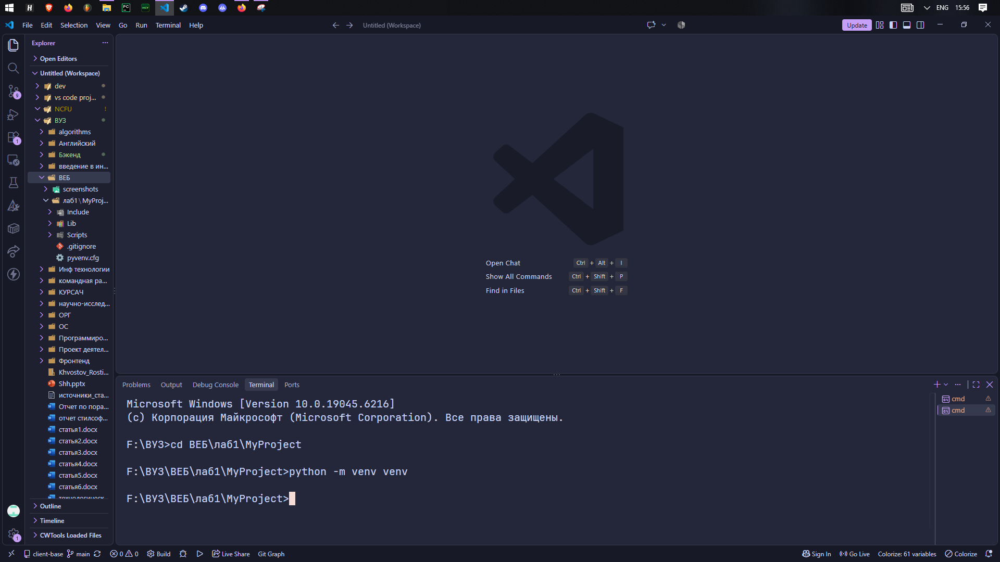
Создал виртуальное окружение

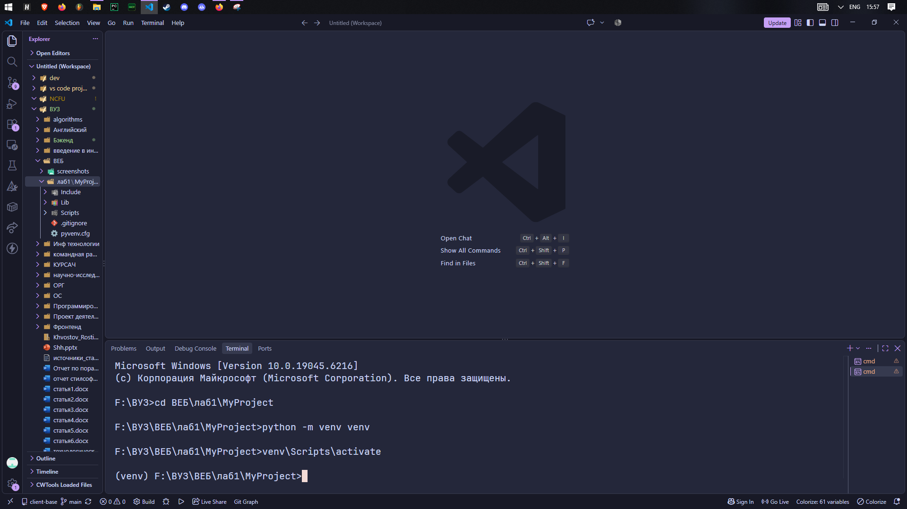
Активировал виртуальное окружение

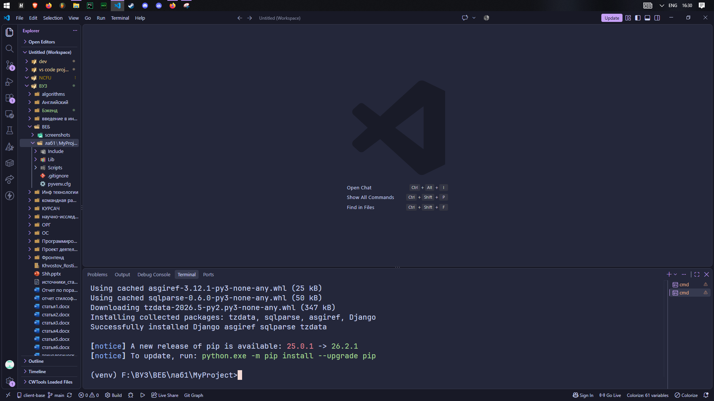
Установил Django

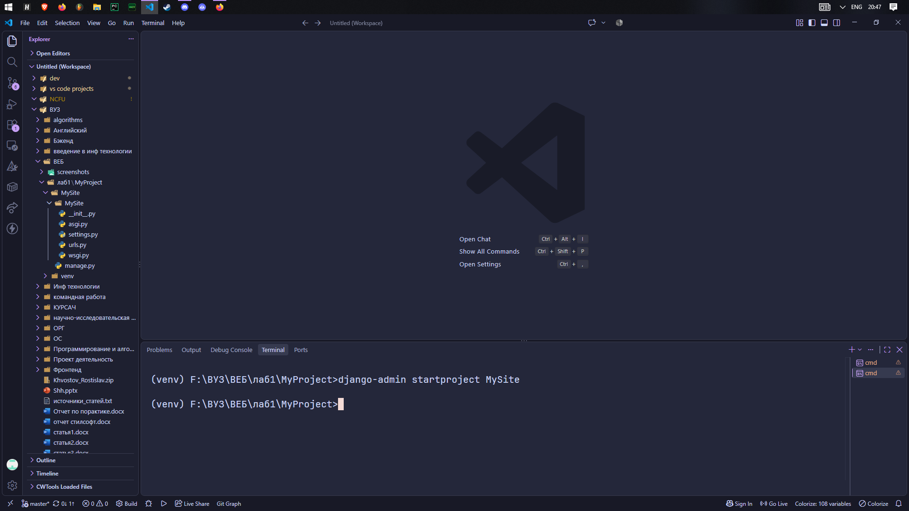
Создал проект

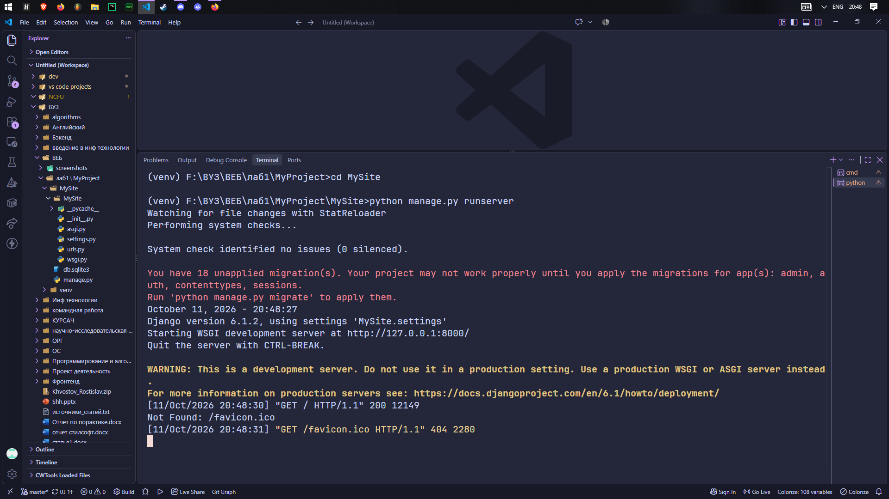
Запустил сервер

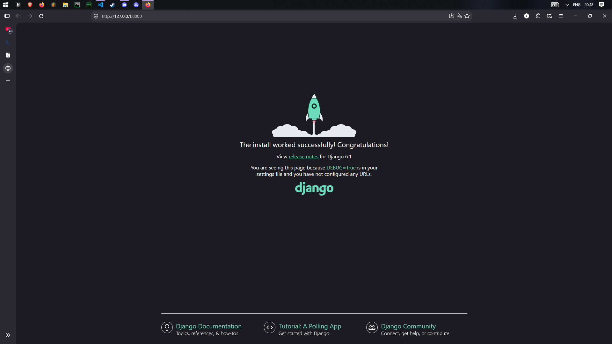
Стандартная страница Django

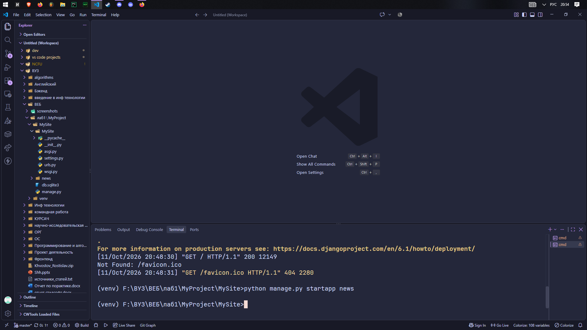
Создал приложение news

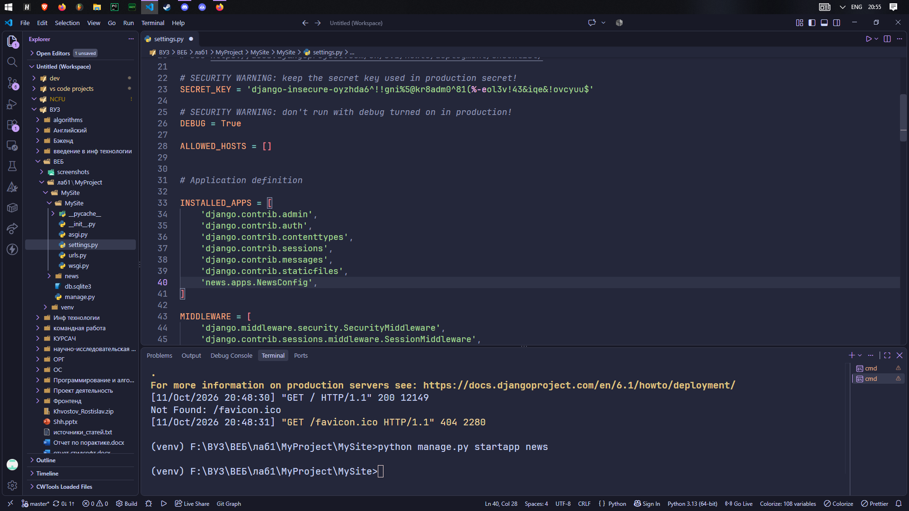
Указал путь к пакету конфигурации в файле settings.py

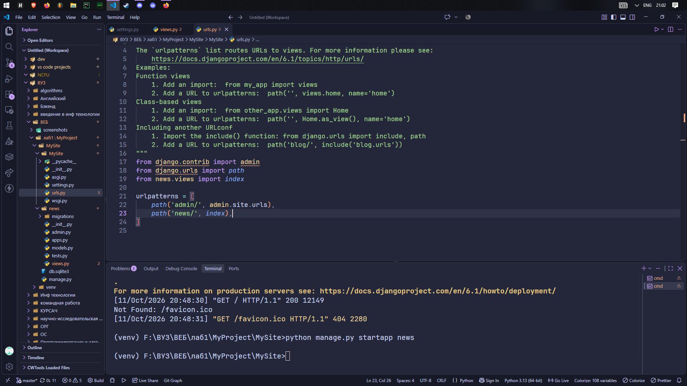
Подключил функцию index и добавил новый маршрут news/

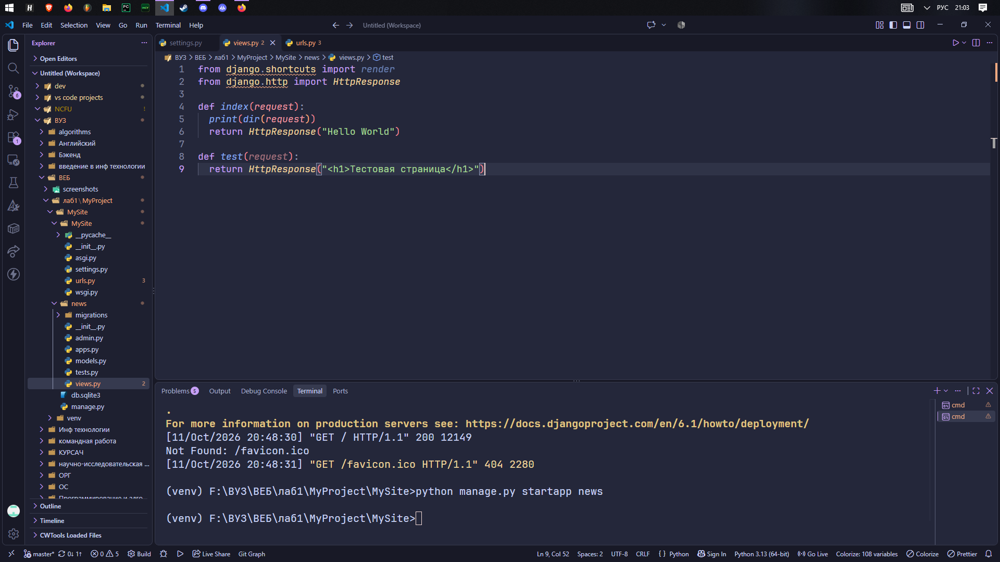
Создал функции index и test

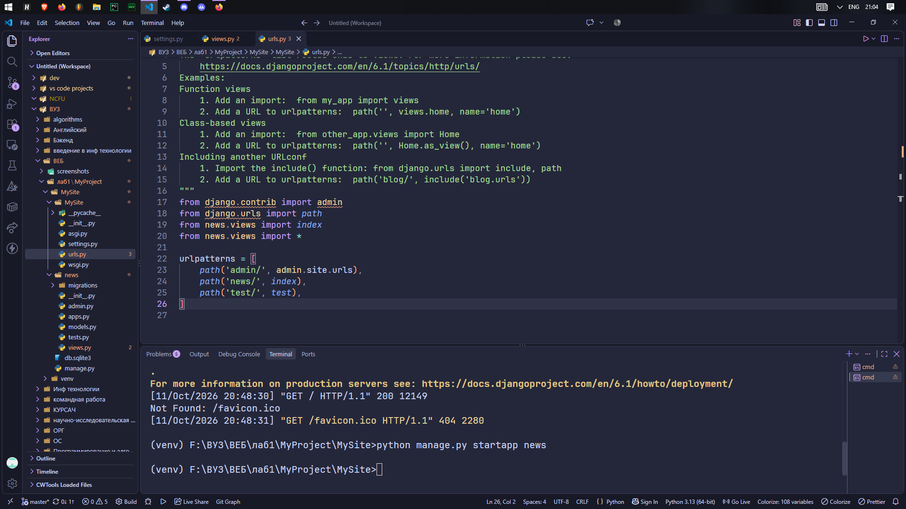
Импортировал все функции и добавил маршрут test/

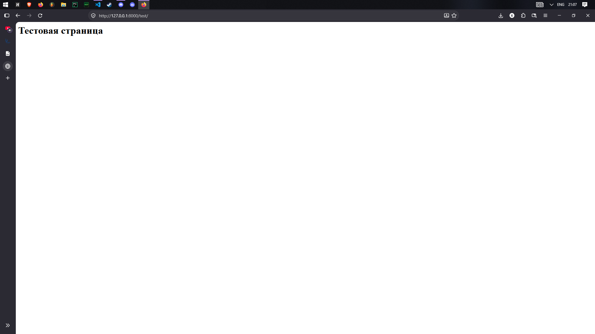
Страница test/ в браузере

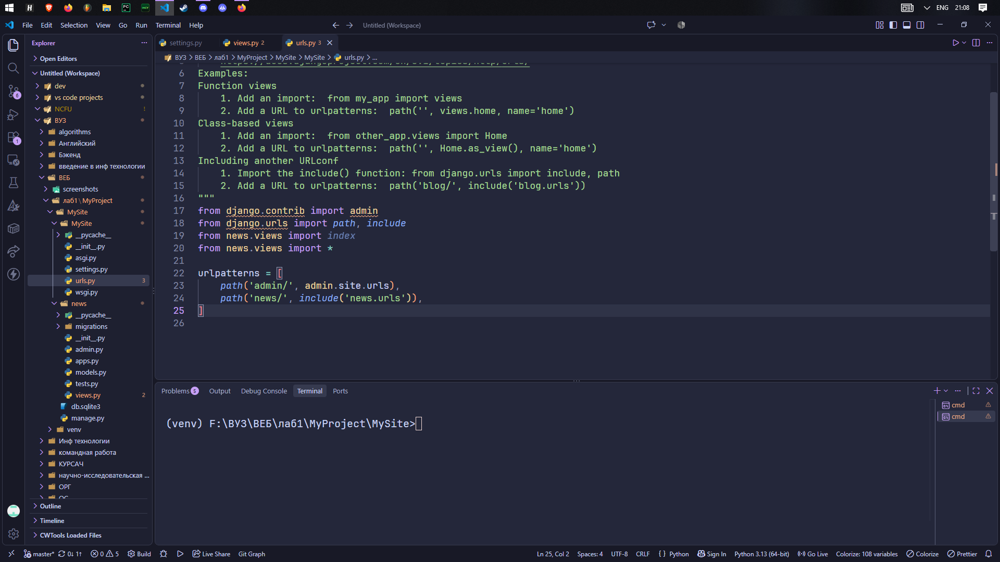
Импортировал все маршруты из news.urls

Создал переменную urlpatterns в news/urls.py и импортировал функцию path

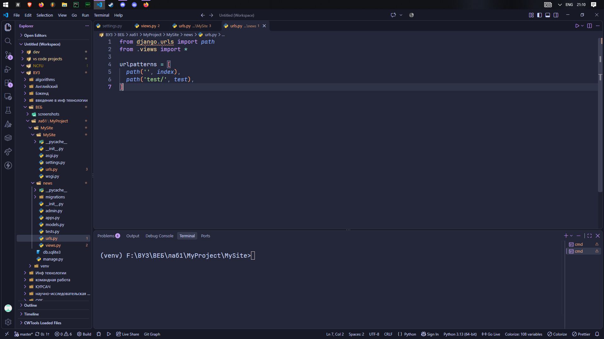
Добавил в urlpatterns список адресов

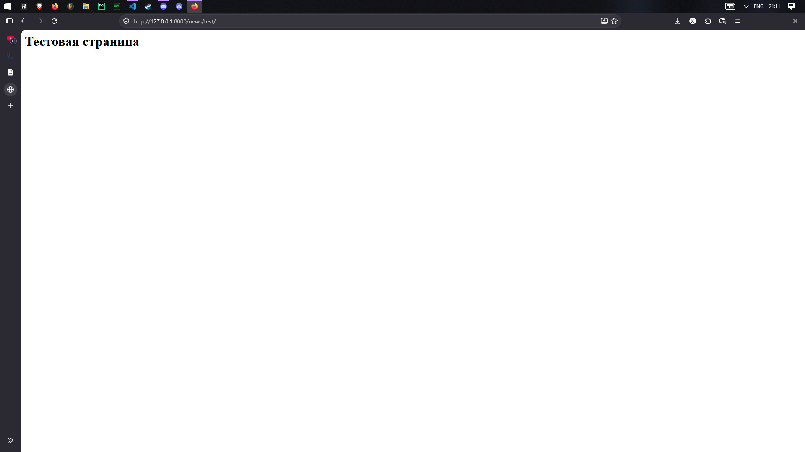
Страница news/test/ в браузере
