# Лабораторная работа №1: настроить виртуальное пространство. Разработать контроллер приложения и организовать маршруты

**Студент:** Хвостов Ростислав Романович

**Группа:** ПИЖ-б-о-25-2

## Цель работы
Настроить виртуальное пространство. Разработать контроллер приложения и организовать маршруты

## Ход работы
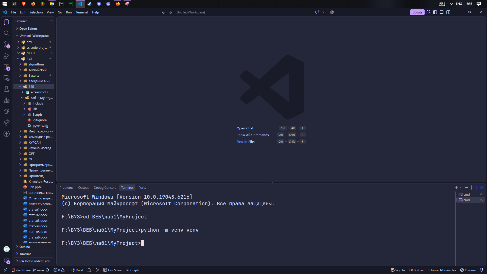
Создал виртуальное окружение

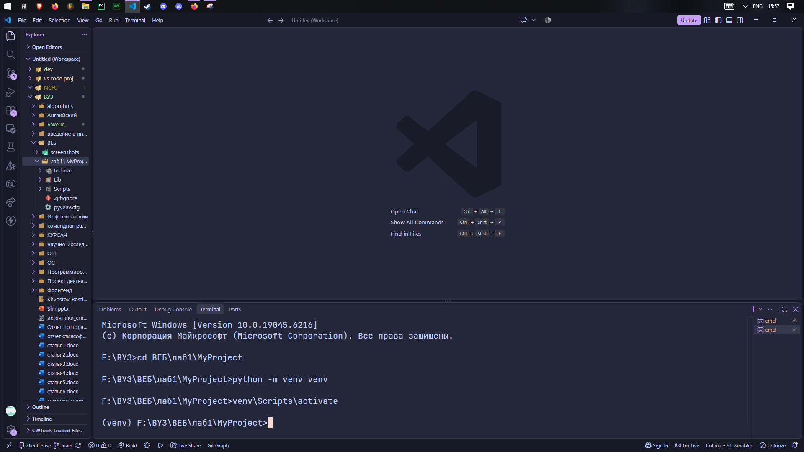
Активировал виртуальное окружение

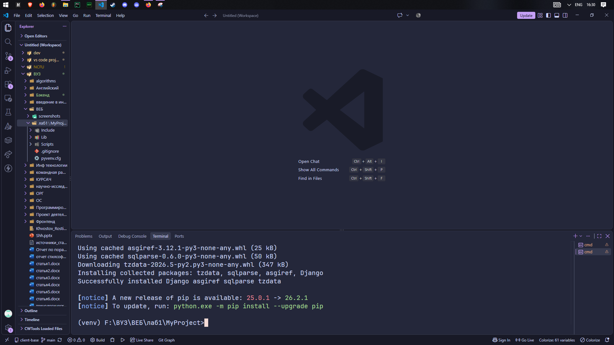
Установил Django

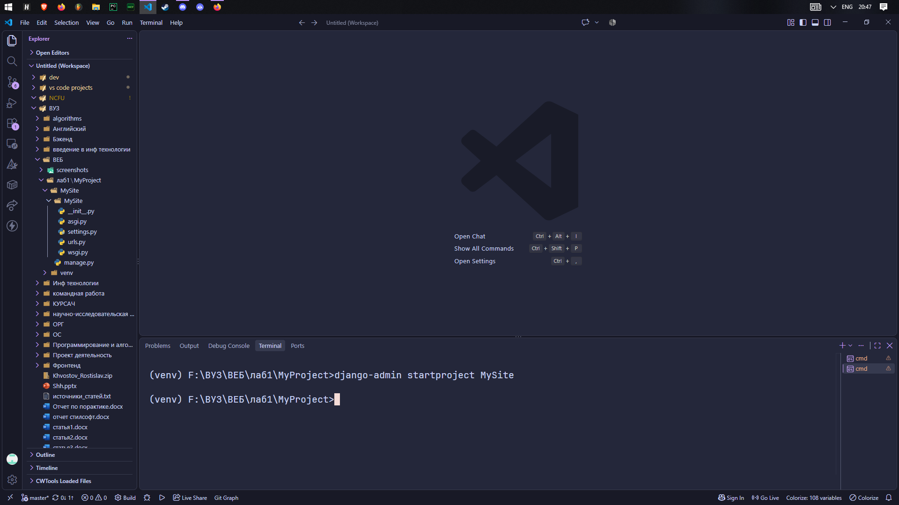
Создал проект

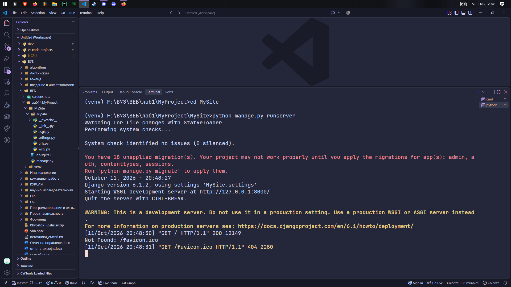
Запустил сервер

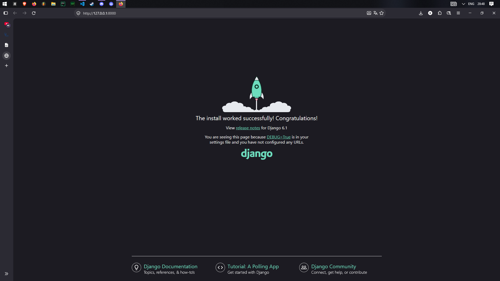
Стандартная страница Django

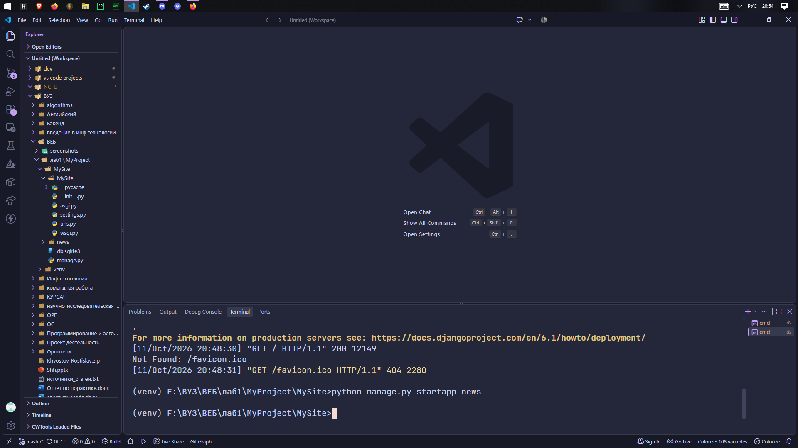

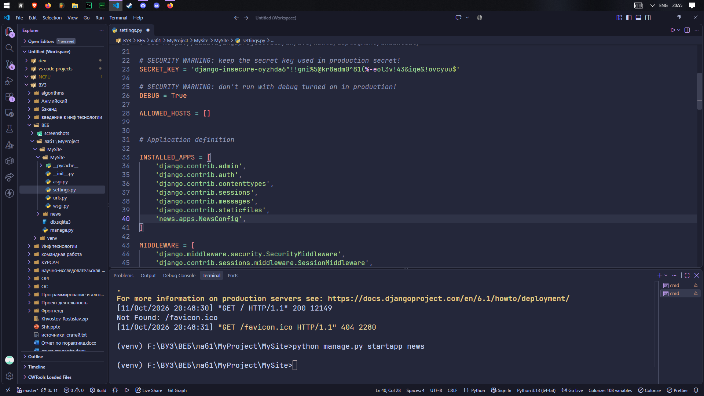

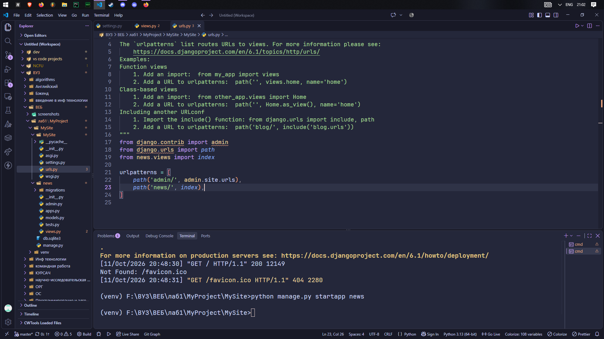

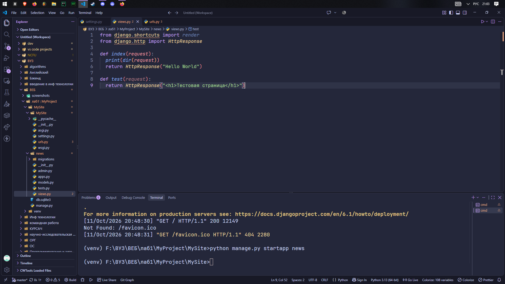

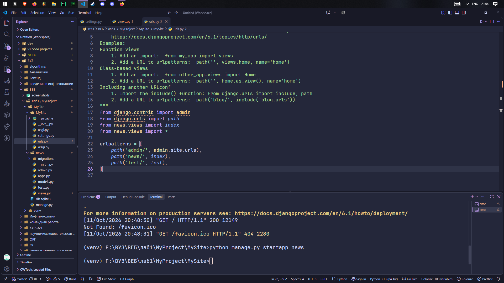

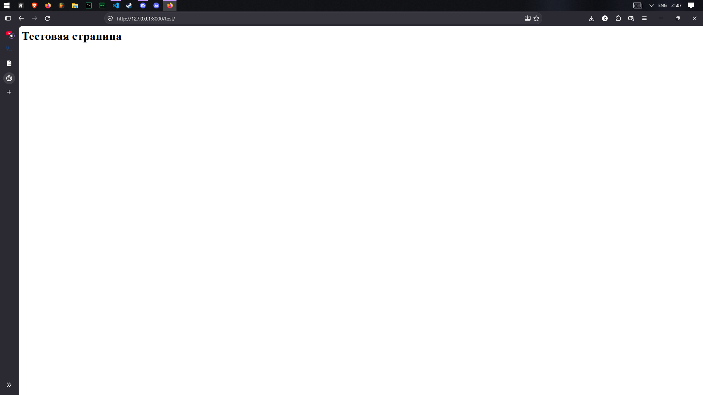

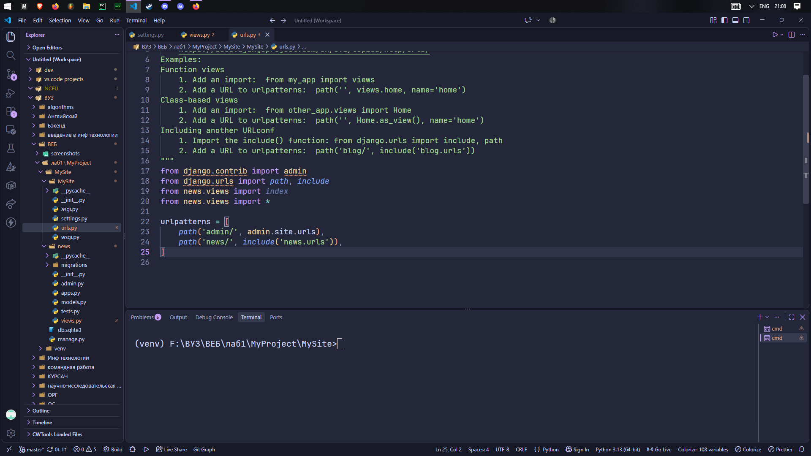

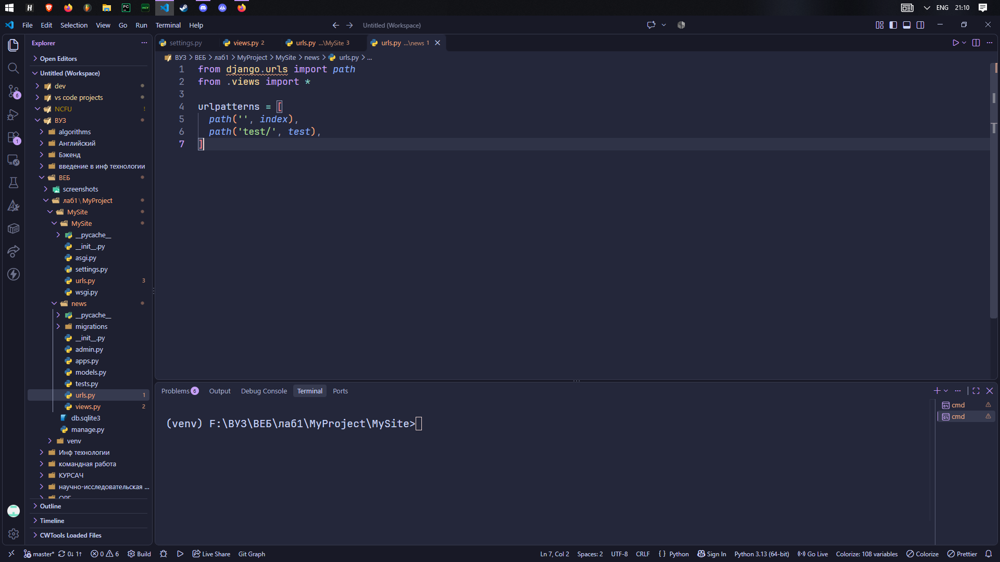

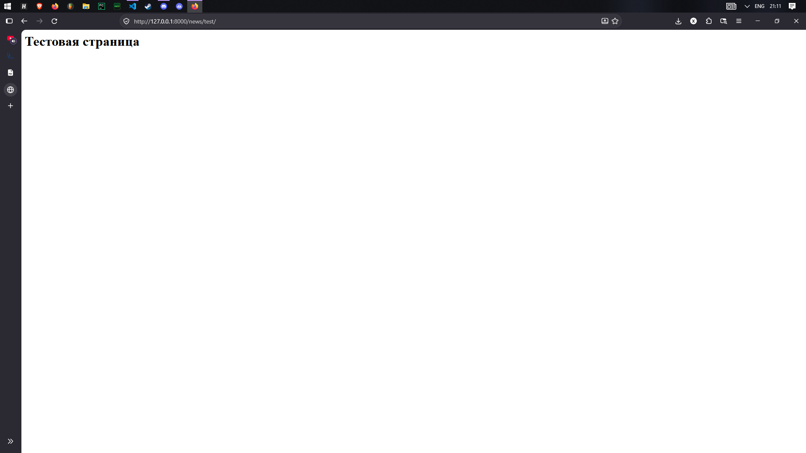
